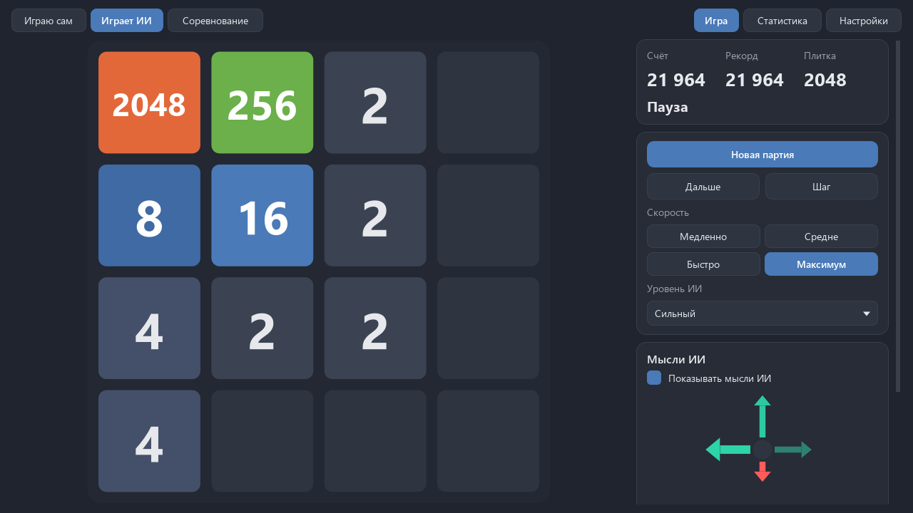

# 2048Ai

The 2048 puzzle plus an AI that taught itself to play it. Windows, Python, PySide6 and
numpy - no PyTorch, no pygame. Русская версия: [README.ru.md](README.ru.md).



## Features

- **I play.** Classic 2048 with arrow keys, WASD or a mouse swipe. *Undo* restores the board
  and the random generator too, so undo can't fish for a better tile. *Hint* draws the best
  move on the board and rates every direction.
- **AI plays.** Watch it play: pause, single step, speed from slow to max.
- **Versus.** You and the AI play two boards with one random seed: both get the same new
  tiles. The AI moves after each of your moves. Higher score wins.
- **AI thoughts.** Four arrows: longer and greener is better, plus move values, the expected
  final score and the chance to reach the next tile (from the model passport).
- **Levels.** Novice is an early network snapshot, medium is the trained network alone,
  strong is the network plus expectimax search.
- Statistics for your games and the AI's, versus results, the model passport.
- Light and dark themes, Russian and English, the window remembers its size and place.
- 3×3, 5×5 and 6×6 boards as extras. The AI was trained on 4×4 only, and the game says so:
  on other boards a simple "big tiles in the corner" strategy plays.

## How the AI works

An **n-tuple network** trained by **temporal-difference learning on afterstates**
(Szubert & Jaśkowski 2014; Yeh, Matsuzaki and others). The 4×4 board is one 64-bit
integer, 4 bits per cell. Four 6-cell groups, each applied in all 8 board symmetries, index
lookup tables; a position's value is the sum of 32 table entries. The network learns only by
playing against chance: it picks the move with the best "move reward + value of the board
after the move, before the new tile", and pulls the previous afterstate's value towards
what the next move revealed (TD(0)), or towards zero when the game is over. Hundreds of
games run in lockstep as one numpy batch; errors of a shared weight are averaged across
the batch so that common weights don't get a batch-sized step.

The strong level adds **expectimax** two moves deep: every empty cell and both new tiles
(2 with 90 %, 4 with 10 %), weighted by probability. A position with no moves is worth 0,
so the search sees deadly moves the network alone may miss. The AI sees only the board -
never the seed or the random generator; a test guards that.

## Model passport

1000 games per player, game i has its own seed; tests replay the first games with the same
seeds and compare scores exactly. File: `game/models/passport.json`.

| Player | Average | Best | 2048 | 4096 | 8192 | 16384 |
|---|---:|---:|---:|---:|---:|---:|
| Random moves | 1,102 | 3,484 | 0 % | 0 % | 0 % | 0 % |
| "Big tiles in the corner" | 2,541 | 7,348 | 0 % | 0 % | 0 % | 0 % |
| Novice (snapshot after 1000 games) | 13,290 | 33,804 | 6.2 % | 0 % | 0 % | 0 % |
| Medium (network, no search) | 134,593 | 287,660 | 98.4 % | 94.6 % | 73.8 % | 1.7 % |
| Strong (network + expectimax) | 194,571 | 374,352 | 99.9 % | 99.5 % | 97.6 % | 25.1 % |

**Training:** 500,000 self-play games, 2.27 billion moves, 5.2 hours on one thread
(Ryzen 7 5700X). Learning rate 0.1 for the first 202k games, then 0.01. The model is 29 MB
(int16 npz).

## Run from source

```
pip install -r requirements.txt
python main.py
```

Tests: `pip install -r requirements-dev.txt`, then `python -m pytest -q` (windows are
offscreen only). `python tools/mutation_check.py` breaks the code on purpose and checks
that the tests notice. Training runs only on command:
`python -m game.train trial`, `train`, `export`, `passport` (see README.ru.md).

## Build

`pip install pyinstaller pillow`, then `python build.py`: a `dist/2048Ai` folder, a portable
zip and an NSIS installer.

## License

MIT, see [LICENSE](LICENSE).
