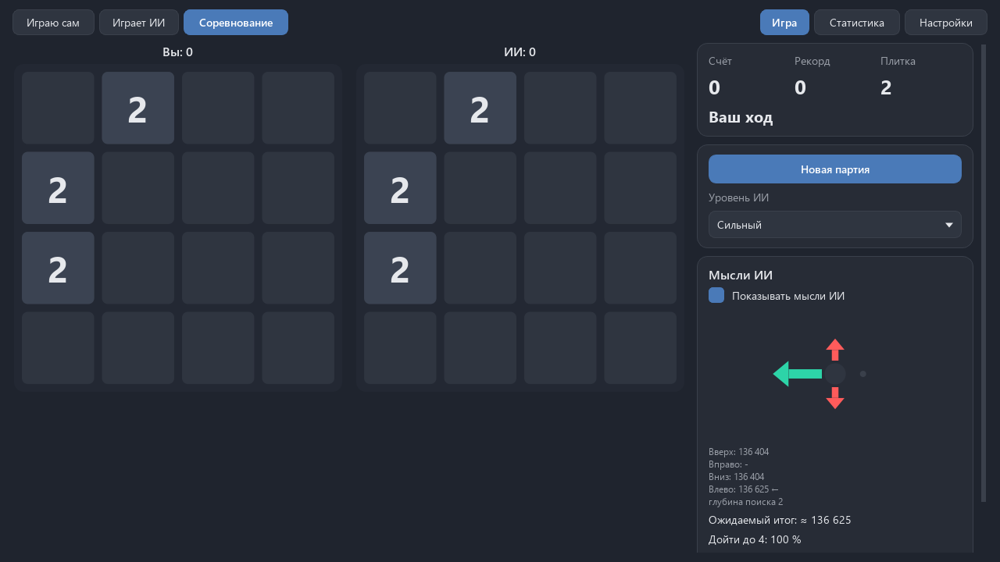

# 2048Ai

Игра 2048 и ИИ, который сам научился в неё играть. Windows, Python, PySide6, numpy - без
PyTorch и без pygame. English: [README.md](README.md).


## Что внутри

- **Играю сам.** Обычная 2048: стрелки, WASD или смахивание мышью по полю. «Отменить ход»
  возвращает и поле, и генератор случайности - отменой не перебрать удачную плитку.
  «Подсказка» показывает лучший ход стрелкой на поле и оценку каждого направления.
- **Играет ИИ.** Смотрите, как он ведёт партию: пауза, шаг по одному ходу, скорость от
  «медленно» до «максимум».
- **Соревнование.** Вы и ИИ играете на двух полях с одним зерном случайности: новые плитки
  у обоих одни и те же. ИИ ходит после каждого вашего хода. Кто наберёт больше.
- **Мысли ИИ.** Стрелки по четырём направлениям: длиннее и зеленее - лучше. Под ними оценки
  ходов, ожидаемый итог партии и шанс дойти до следующей плитки (по паспорту модели).
- **Уровни.** Новичок - ранний снимок сети, средний - обученная сеть без поиска, сильный -
  сеть и поиск expectimax.
- Статистика ваших партий и партий ИИ, итоги соревнований, паспорт модели.
- Светлая и тёмная темы в духе Paint, русский и английский, окно запоминает размер и место.
- Поля 3×3, 5×5 и 6×6 - дополнительно. ИИ учился только на 4×4, и на других полях это
  сказано прямо: там ходит простая стратегия «большие в угол».



## Как устроен ИИ

**N-tuple сеть.** Поле 4×4 хранится одним 64-битным числом: 16 клеток по 4 бита. Сеть
смотрит на четыре группы по 6 клеток (две «полоски» 2×3 и два «уголка»), каждая группа во
всех 8 поворотах и отражениях доски. Степени плиток в группе дают номер строки в таблице,
оценка позиции - сумма 32 значений из таблиц. Это нейросеть с одним слоем, только вход у
неё «один из 16⁶», поэтому вместо умножения матриц - выборка из таблицы. Подход Szubert и
Jaśkowski (2014), развитие у Yeh, Matsuzaki и других.

**Обучение TD на позициях после хода.** Сеть играет сама - против случайности. В каждой
позиции она пробует все четыре хода и выбирает тот, где «очки за ход + оценка позиции после
хода, до новой плитки» больше всего. Оценка прошлой такой позиции подтягивается к тому, что
выяснилось на следующем ходу (TD(0)); если ходов больше нет - к нулю. Сотни партий идут
разом пачкой: numpy считает их одной операцией. Чтобы общие веса (пустая строка в начале
партии) не получали шаг, умноженный на размер пачки, ошибки одного веса в пачке
усредняются.

**Expectimax.** Сильный уровень смотрит на два своих хода вперёд: после каждого хода
перебираются все пустые клетки и обе новые плитки (2 с вероятностью 90 %, 4 - 10 %),
и всё складывается со своими вероятностями. Позиция без ходов стоит 0 - так поиск видит
смертельные ходы, которых сеть может не заметить. Подсказка в окне смотрит до трёх ходов
вперёд с лимитом времени.

**Честность.** ИИ получает только поле - не зерно и не генератор случайности. Будущих плиток
он не знает; это закрыто тестом.

## Паспорт модели

Цифры паспорта (по 1000 партий на уровень) появятся после полного прогона сильного уровня.

## Запуск из исходников

```
pip install -r requirements.txt
python main.py
```

- `python main.py --selftest итог.txt` - самопроверка без экрана (её же делает собранный exe).
- `python -m pytest -q` - тесты (окна только offscreen, без видимых окон).
- `python tools/mutation_check.py` - мутационная проверка: код портится нарочно, тесты должны это поймать.

## Обучение

Только по команде, в один поток и с пониженным приоритетом - ПК остаётся отзывчивым.

```
python -m game.train trial --minutes 10        # замер скорости и прогноз времени
python -m game.train train --run runs/main --games 500000 --decay-at 350000
python -m game.train export --run runs/main --out game/models/net.npz
python -m game.train passport --run runs/main  # 1000 партий на уровень
```

Журнал (`log.txt`, `log.jsonl`), снимки весов и продолжение с места (`--resume`) - в
папке запуска; файл `STOP` в ней останавливает обучение со снимком.

## Сборка

```
pip install pyinstaller pillow
python build.py
```

Получаются папка `dist/2048Ai`, portable-архив и установщик NSIS. Рядом с exe в portable
лежит `portable.txt`: настройки и статистика пишутся в папку `saves` рядом, а не в профиль.

## Устройство папки

По контракту ИИ-Игротеки: `game/` - всё своё (`core` - правила, `ai` - сеть, поиск и уровни,
`train` - обучение и паспорт, `ui` - окно, `models` - модели и паспорт), `aikit/` - общий
набор игр (темы, окно, настройки, статистика, звук), `main.py` - отдельный запуск.

## Лицензия

MIT, см. [LICENSE](LICENSE).
